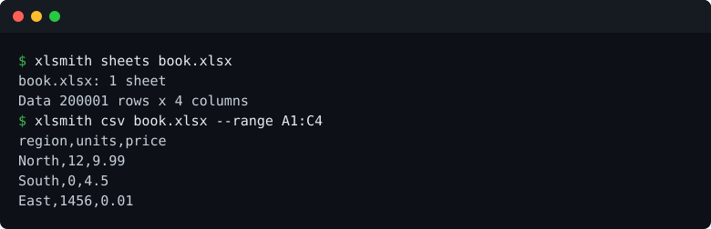

# xlsmith

Read a spreadsheet and get the data out as CSV or JSON. No Excel, no LibreOffice, no Python.



```
cargo install xlsmith
```

## What it does

| | |
|---|---|
| `sheets <file>` | every sheet, with row and column counts |
| `csv <file>` | one sheet, or every sheet with `--all-sheets <dir>` |
| `json <file>` | one sheet, or `--header` to use the first row as keys |
| `--sheet` | a sheet by name, or by its position counting from 1 |
| `--range` | one block, as in `A1:D100` |
| `--delimiter` | comma, tab or semicolon |

`.xlsx`, `.xls`, `.xlsb` and `.ods` go in. Output goes to standard output unless you pass `-o`, so it pipes.

Exit codes: 0 the data was written, 1 the file could not be read or written, 2 the sheet or range does not exist.

Errors come out as Excel writes them (`#DIV/0!`), text stays text, numbers stay numbers, dates come out as `YYYY-MM-DD`.

## Measured

| | |
|---|---|
| 200,000 rows | 0.89 s |
| Output | byte for byte what `xlsx2csv` writes |
| Memory | the whole sheet, so a 500 MB workbook needs about 500 MB of RAM |

Full table: [BENCHMARKS.md](BENCHMARKS.md).

## What it will not do

- **Calculate formulas.** You get the value the file last saved. If nothing ever calculated it, there is no value, and xlsmith will not invent one.
- **Write spreadsheets.** There is no CSV to xlsx direction.
- **Carry anything but data.** No styles, images, charts, pivot tables or macros. An `.xlsm` is read for its data and its macros are ignored.

## From Rust

```rust
use xlsmith::Book;

let mut book = Book::open("report.xlsx")?;
let rows = book.rows(Some("Q3"), None)?;   // Vec<Vec<String>>
```

`CellRange::parse` takes the same `A1:D100` text the command line takes, and `write_csv` and `write_json` are public, so your own code prints in the same shape as the program.

## Licence

Apache-2.0. Free to use, and there is no plan to charge for it.
